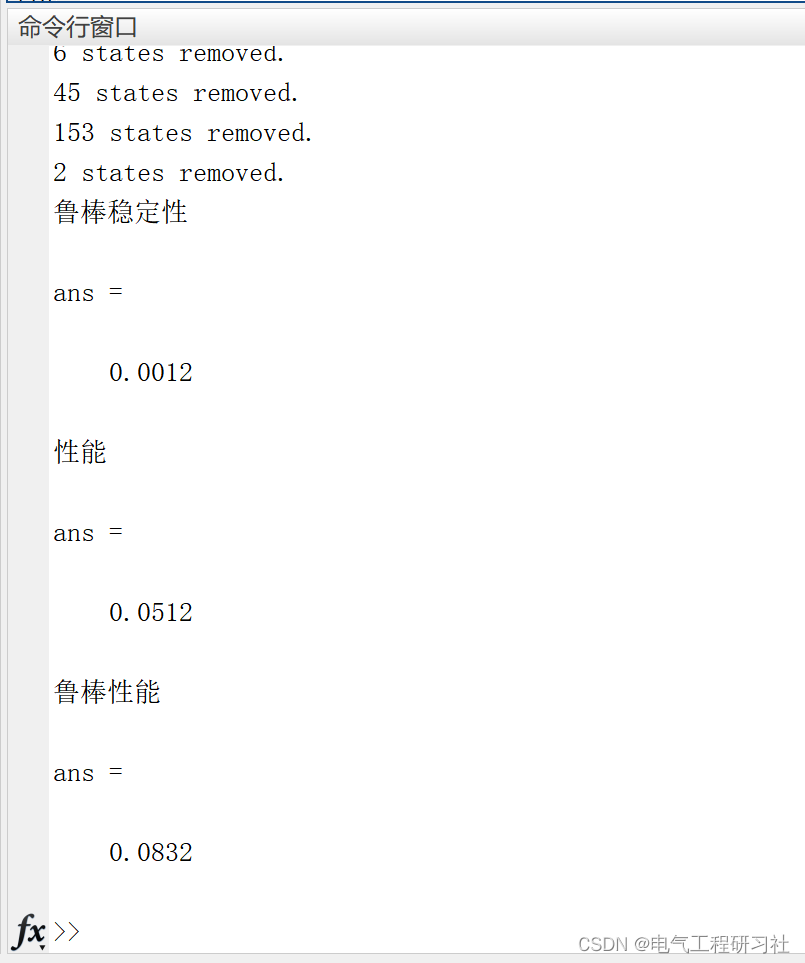
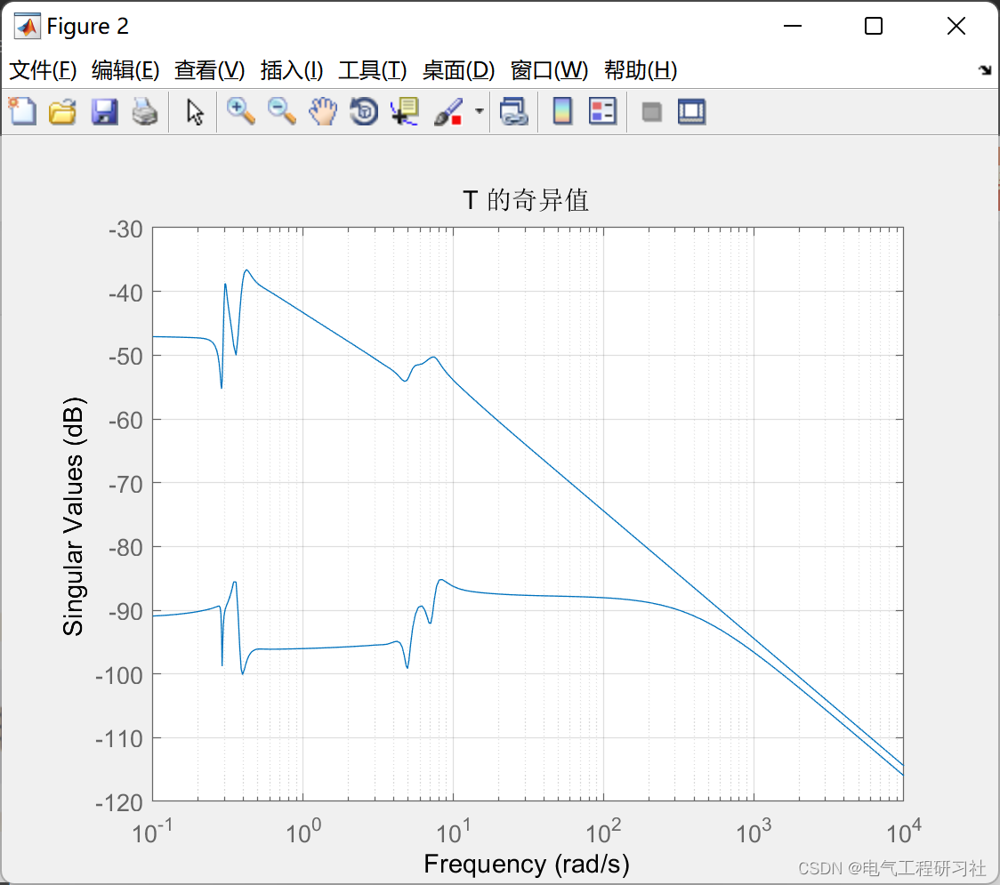
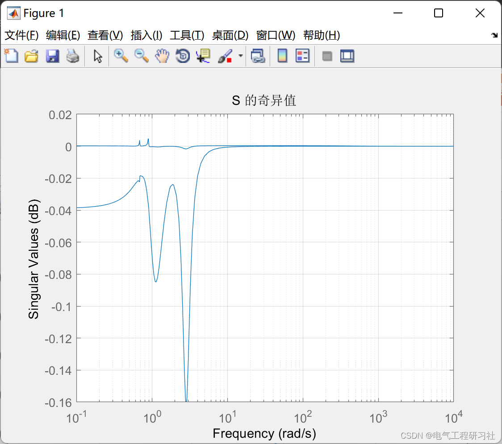
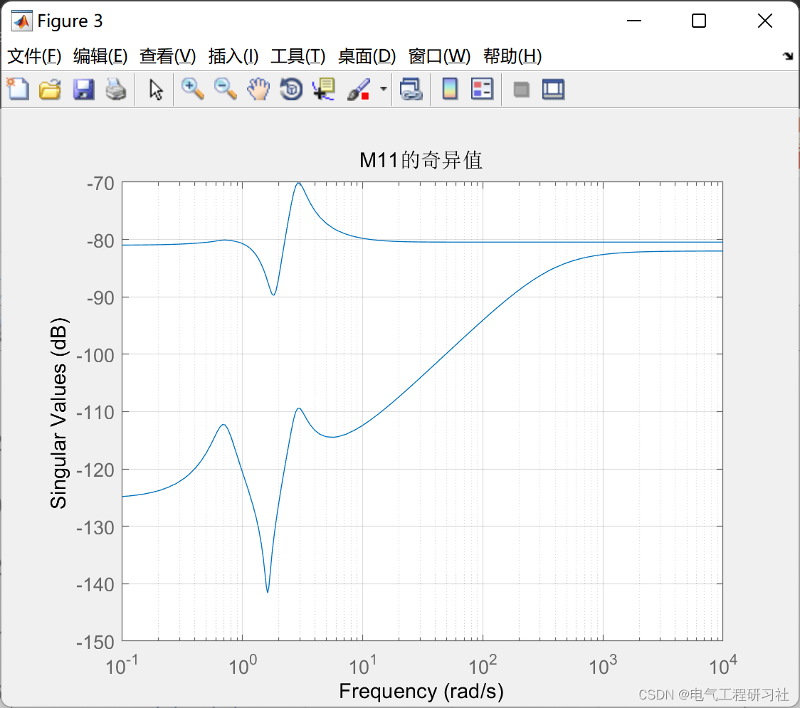
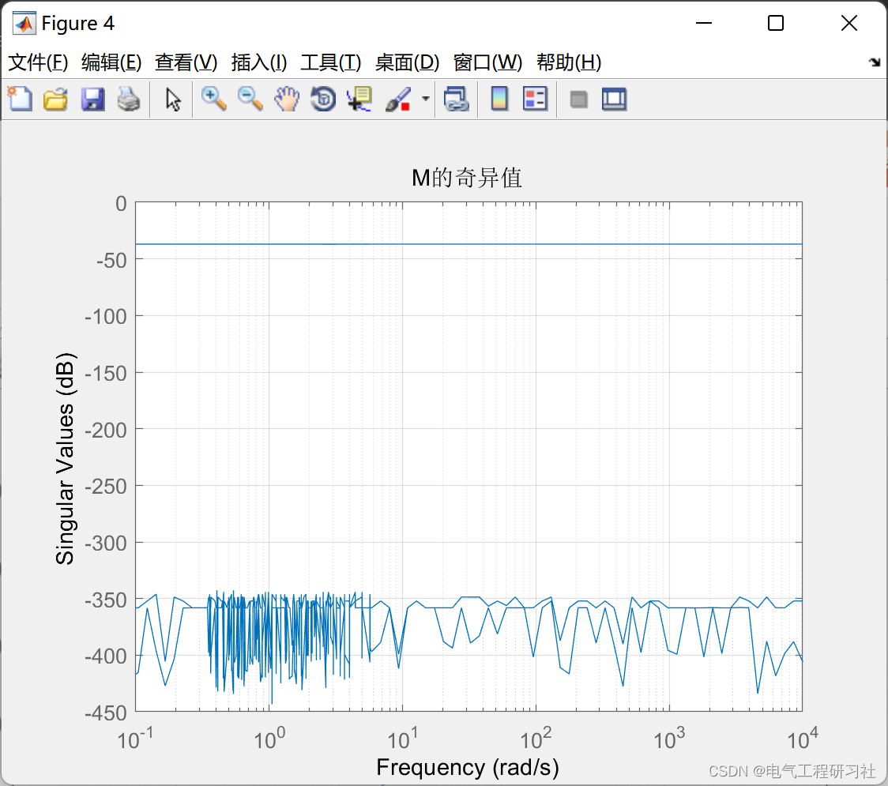

# Robustness Study of Microgrids (Matlab Code Implementation)

​  
📋📋📋 This article is organized as follows: ⛳️⛳️⛳️ 1. Overview 2. Microgrids 3. Operational Results 4. MATLAB Code Implementation 5. References 6. Final Thoughts
1. Overview During the manufacturing, assembly, and usage of electrical equipment, unpredictable factors such as manufacturing deviations, material properties differences, and changes in working environments inevitably occur. These uncertainties often cause the actual parameters of electrical equipment to deviate from their original design values, leading to a decrease in product performance and even accidents. To mitigate the negative impact of these uncertainties on electrical equipment while balancing the relationship between reliability, robustness, and other performance indicators, it is necessary to consider engineering uncertainty during the optimization design stage of electrical products.Considering robustness and reliability, this paper aims to address the standard issues in electromagnetic field analysis methods within the electrical engineering field, as well as optimization problems in permanent magnet rings and permanent-magnet synchronous motors. The main work completed is as follows: Firstly, under the influence of uncertainties, to ensure the reliability and robustness of electrical equipment, this paper studies a scientifically optimal weight-assisted design method that balances both reliability and robustness (ω-RBRDO). This method takes into account both reliability and robustness indicators. By ensuring that constraints are satisfied at a certain probability level, it guarantees the reliability of the designed solution. At the same time, to seek the optimal proportion coefficient for balancing the robustness indicator and the objective performance, the concept of optimal weights is introduced.
2 This section of the microgrid is quite extensive, and interested readers can search for it:  
​Edit  
3 Operational results ​Edit  
​Edit  
​Edit  
​Edit  
​Edit  
4 The Matlab code implementation of this paper only showcases a portion of the code; the full code can be found in:
%% Singular values of the sensitivity function\nfigure(1)\nS = (eye(2,2) - P0*K_s)^-1;\nsigma(minreal(ss(S)))\ntitle('S The singular value')\ngrid on\n\n\n%% singular values of complementary sensitivity function\nfigure(2)\nT = P0*K_s*(eye(2,2) - P0*K_s)^-1;\nsigma(minreal(ss(T)))\ntitle('T The singular value')\ngrid on\n%saveas(gcf,'T_sigma.png')\n\n%% The singular values of M11\nfigure(3)\nM = lft(Q_ss,K_s);\nM11 = M(1:2,1:2);\nsigma(minreal(ss(M11)))\ngrid on\ntitle('M11The singular value')\n%saveas(gcf,'M11_sigma.png')\n\n%% The singular values of M\nfigure(4)\nsigma(minreal(lft(Q,K_s)))\ntitle('MThe singular values')\ngrid on\n%saveas(gcf,'M_sigma.png')\n\n%% Robust Stability\nrbst_s = Wa*K_s*(eye(2,2) - P0*K_s)^-1;\ndisp('Robust stability')\nnorm(rbst_s,inf)\n\n%% Performance\nnmnl_p = Ws*((eye(2)+P0*(eye(2,2) - P0*K_s))^-1);\ndisp('Performance')\nnorm(nmnl_p,inf)\n\n%% Robust performance\nrbst_p = [rbst_s;nmnl_p];\ndisp('Robust performance')\nnorm(rbst_p,inf)\n\n%% Output\nA_k = K_ss.A;\nB_k = K_ss.B;\nC_k = K_ss.C;\nD_k = K_ss.D;\nsave('shuju','A_k','B_k','C_k','D_k')\nreturn\n  
References:
[1] Guo Zijuan. Research on Energy Management Strategy for Distributed Energy Storage Microgrids [D]. Guangdong University of Technology, 2022.
[2] Sun Yuan. Research on Optimal Methods for Engineering Electrical Magnetic Problems Considering Robustness and Reliability [D]. Shenyang University of Technology, 2022. DOI: 10.27322/d.cnki.gsgyu.2022.000091.

End of the paper:
The references are theoretically cited from online academic databases. If any infringement is found, please contact the blogger to delete them.

## Images

<!-- PAYMENT_BLOCK -->

## Get this dataset

- Payment link (Stripe): [Buy now](https://buy.stripe.com/3cs8yP7sY87d0vu9AB)
- Payment QR code: 

<!-- /PAYMENT_BLOCK -->
